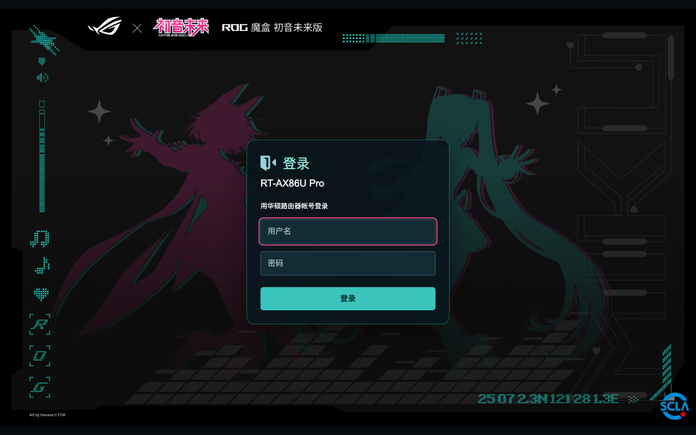

# Hatsune Miku Theme + Wi-Fi Boost

[简体中文](README.md) · [English](README.en.md)

One ASUSWRT-Merlin software-center module combining a full Miku theme with local Wi-Fi power controls. No machine codes, activation keys, payment screens, or online licensing are required.



## Features

- Original artwork, Miku teal (`#39C5BB`) and pink accents, with the existing Merlin menus and settings.
- Full branded login artwork with its header, border and credits visible. Portrait layouts place the form below the complete image.
- A dedicated character banner above the toolbar, avoiding the original 54 px header crop.
- Independent 2.4 GHz / 5 GHz controls, temperature and driver power readings, calibration limits, read-only previews, local backups and restore.
- dBm and converted mW shown together for readings and sliders, a visible disclaimer, and a **Back to Software Center** button at the top of both tabs.
- Live telemetry every second: both radio temperatures on a two-minute chart, connected-client counts, upload/download rates per band and combined totals. Sampling pauses in background tabs. Rates use driver counter deltas, include local traffic, and may be affected by hardware acceleration.
- One installed module with **Appearance** and **Wi-Fi Boost** tabs; reversible theme overlays and legacy-plugin rollback.

## Compatibility and installation

The installer currently accepts **RT-AX86U Pro (`RT-AX86U_PRO`) only**. The development device runs Merlin/KoolShare `3006.102.9_0` with external JFFS. Other models and firmware have not been verified. Do not remove the model guard to force installation.

Download `mikuui-2.0.0.tar.gz` from [Releases](https://github.com/HachiMiku39/Asus_router_Miku_theme/releases), upload it through the software center's offline/manual installation page, then open the combined module. Apply the theme and refresh the browser.

Wi-Fi support requires Broadcom `wl`, the running calibration snapshot and the firmware's native `hndnvram.sh` interface. Install, status and preview do not alter radio power or reboot. **Applying changed power settings or restoring calibration requires confirmation and restarts the router.** Region, proxy, firewall, LAN/WAN, airtime-fairness and beamforming settings are preserved. Requested calibration limits do not guarantee the same live transmit power; regional and driver limits still apply.

Power calibration persists independently of USB storage. Disabling the theme, removing USB storage or uninstalling does not undo power changes; use the backup-restore action when needed.

## Backups

Backups remain on the router under `/jffs/mikuui-backups/`, protected by file hashes and a device-identity check. They are never exposed through the UI, included in the package, or uploaded to this repository. Existing associated legacy backups are migrated when available. Otherwise the backup captures the configuration before this module's first application, which is not necessarily an untouched factory configuration.

Legacy Wi-Fi Boost files and registration metadata are retained privately for rollback. Only its specific files are moved; shared resources are preserved. Uninstall restores the previous plugin when one existed, restores the firmware appearance, and retains private backups.

The Wi-Fi backend is a local implementation without a payment or activation mechanism. Legacy activation data is used only to locate an existing backup during migration and is never needed for a new installation.

## Build and verification

```sh
python3 -m unittest discover -s tests -v
python3 build.py
```

Packages and SHA-256 checksums are produced in `dist/`. Offline tests use synthetic calibration fixtures. Release notes distinguish actual UI, installation and read-only checks from unexecuted power writes or reboot tests.

Code licensing is in [LICENSE](LICENSE). Bundled artwork and trademarks are excluded from that license; see [ASSETS.md](ASSETS.md). Original artwork credit: **Art by Hanasa © CFM**.
