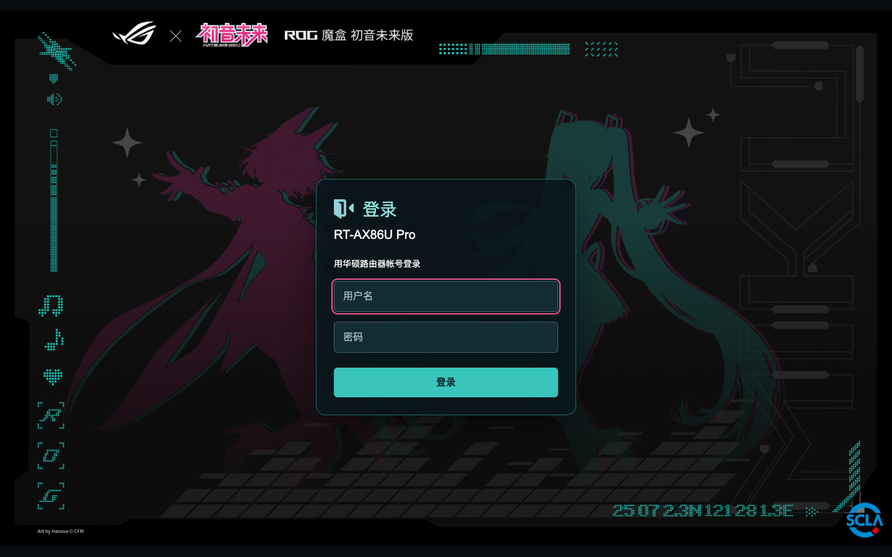
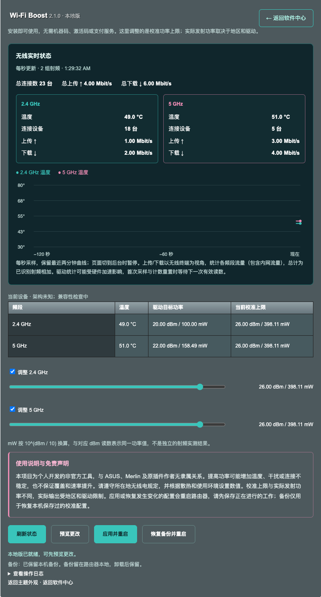

# 初音未来主题 + Wi-Fi Boost

[简体中文](README.md) · [English](README.en.md)

一个 ASUSWRT-Merlin 软件中心模块，整合完整初音未来主题与本地 Wi-Fi 功率调节。安装后即可使用，没有机器码、激活码、支付页面或在线授权依赖。



## 功能

- **完整初音主题**：原包素材、`#39C5BB` 主色和粉红点缀，保留 Merlin 菜单与设置流程。
- **登录页**：使用带联名标题的完整原图，保留顶部标识、边框与底部署名；桌面按比例完整展示，竖屏把表单放到完整图片下方。
- **后台横幅**：角色原图独立显示，操作栏位于下方，避免被原有 54px 页眉裁切。
- **Wi-Fi Boost 本地版**：读取兼容频段的温度、驱动目标功率和校准上限；提供 2.4 GHz / 5 GHz 单独调节、只读预览、备份和恢复。
- **清楚的功率显示**：读数和滑块同时显示 dBm 与换算的 mW；页内常驻免责声明，两个页签顶部均有“返回软件中心”按钮。
- **每秒实时监控**：各射频温度曲线（最近两分钟）、各频段连接设备数、上传和下载速率，以及所有已识别射频合计；切到后台自动暂停。流量按驱动计数差值计算，含内网流量，可能受硬件加速影响。
- **一个安装包、一个模块**：软件中心只有一个入口，内含“主题外观”和“Wi-Fi Boost”两个页签。
- **恢复与卸载**：主题可以一键恢复；外置 JFFS 不可用时恢复网页原貌。原 Wi-Fi Boost 插件文件可本地回滚。

<details><summary>Wi-Fi 页签预览（模拟状态数据）</summary>



</details>

## 适配范围

目标平台为 **ARMv8 的 ASUSWRT-Merlin / KoolShare 设备**，需要已有软件中心、DBus 和兼容的 Merlin 网页接口。安装器不再按路由器型号白名单限制；包内为 Shell / AWK / JavaScript / CSS 和图片，不含绑定单一型号的二进制程序。

| 功能 | 检测与支持范围 |
| --- | --- |
| 初音未来主题 | ARMv8 + 经典 Merlin 网页接口；不依赖无线芯片型号 |
| 每秒实时监控 | 自动发现射频与接口，支持不同频段顺序、多个 5 GHz 射频和 6 GHz；需要驱动提供 `wl` 读数，不可读项明确显示 |
| 功率预览、应用和恢复 | 目前适配 **一组 2.4 GHz + 一组 5 GHz 的 Broadcom HND 校准接口**；检查两组接口身份、唯一校准前缀、NUL/文本格式、字段、逐字节还原和挂载工具后开放 |
| 其他无线芯片、三频/四频、未知校准格式 | 主题保留；监控按可读项目显示；功率操作禁用并说明原因 |

**ARMv8 是安装目标，不等于所有设备的功率分区通用。** 已完成实机检查的设备仍只有 RT-AX86U Pro / `3006.102.9_0`；其他机型属于按接口检测的理论兼容，未经逐台实测。三频/6 GHz 的识别与页面已做模拟验证，不代表相应硬件的功率写入已适配。支持原生 AArch64/arm64，以及 CPU 明确报告 ARMv8 或设备树为 Cortex-A53/A72 的部分 32 位内核系统。

完整条件与限制见 [兼容性说明 / Compatibility](COMPATIBILITY.md)。普通原版 Merlin 如果没有软件中心，不能直接通过本项目安装器安装。

## 安装

1. 从 [Releases](https://github.com/HachiMiku39/Asus_router_Miku_theme/releases) 下载 `mikuui-2.1.0.tar.gz`。
2. 在软件中心的“离线安装 / 手动安装”中上传该文件。
3. 打开“初音未来主题 + Wi-Fi Boost”。在“主题外观”中应用主题，再刷新页面。
4. 在“Wi-Fi Boost”中刷新状态、选择频段与数值，先预览更改，再按需应用。

安装、刷新状态、参数预览不会改变无线功率，也不会自动重启。**应用功率或恢复校准备份时，如果配置发生变化，会在确认后重启路由器，连接会短暂中断。** 当前地区、代理、防火墙、LAN/WAN 和波束成形设置保持原值。实际发射功率仍取决于地区限制、驱动和无线工作状态；滑块表示校准上限，不代表实时发射功率。

功率配置保存到固件的无线校准文件，生效后不依赖 USB。恢复默认外观、拔出 USB 或卸载主题不会自动撤销功率调整，需要使用“恢复备份并重启”。

## 备份与原插件迁移

- 首次应用前在路由器本地备份校准文件；校验备份哈希和本机身份后才允许恢复。
- 通过功率兼容检查且装有原 Wi-Fi Boost 时，会优先迁移其关联的已有备份，避免覆盖原先保留的配置。
- 原插件的独立文件和模块登记信息保存在路由器私有目录，并移出软件中心的独立入口；卸载整合模块时恢复这些文件。不会调用原插件的广泛清理脚本，也不会删除其共享资源。
- 私有备份位于 `/jffs/mikuui-backups/`，不会包含在源码、安装包或状态接口中；卸载后保留。
- “恢复备份”恢复所保存的校准配置。如果原来没有可迁移备份，它就是首次使用本模块时的配置，不能据此推断为未修改的出厂状态。

Wi-Fi 后端是本项目的本地实现，没有保留支付、授权验证或机器码生成流程。旧版激活信息只在迁移时用于定位旧备份，不是新模块运行的条件；未安装过原插件也可使用。

## 构建与验证

```sh
python3 -m unittest discover -s tests -v
python3 build.py
```

构建产物位于 `dist/`，附 SHA-256。测试覆盖参数边界、注入字符串、频段选择、十六进制/十进制和数组形式的校准值、未知格式与缺失字段，以及 NUL 分隔校准文件的逐字节还原和异常格式拒绝。测试使用虚构配置，不访问路由器或修改无线功率。

本地验证分为网页/安装检查、只读硬件检查与真正的功率应用。发布说明记录实际完成的验证范围；没有执行的写入或重启不会被列为通过。

## 素材与许可

程序代码见 [LICENSE](LICENSE)。原包插画和 ASUS / ROG / 初音未来标识不在程序代码许可范围内，原始文件保持不变，哈希见 `mikuui/assets/ORIGINAL-ASSETS.json`。署名：**Art by Hanasa © CFM**。详见 [素材说明](ASSETS.md)。
